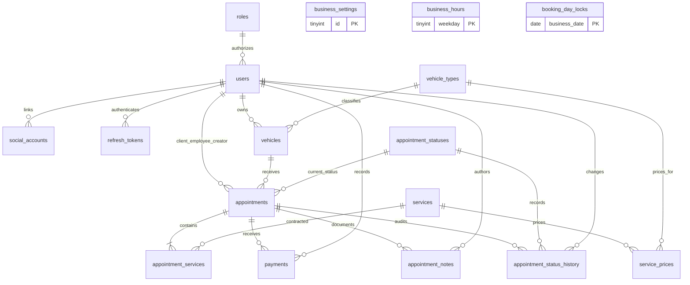

# MySQL — modelo, diccionario y normalización

Versión objetivo: **8.4 LTS**, motor InnoDB, utf8mb4. Nombres en inglés, textos UI en español.
`BIGINT` se serializará como string en JSON para no superar el entero seguro de JavaScript.
Fechas en UTC, importes en centavos ARS. No se guardan access/refresh tokens legibles.

## Entidades y relaciones

La relación "turno contiene al menos un servicio" se valida en la transacción de creación,
no con una FK inversa. Un turno pendiente puede no tener empleado.

## Formas normales

**1FN:** columnas atómicas. Servicios del turno, cuentas sociales y pagos son filas distintas;
no hay arrays de servicios, listas de días ni columnas servicio1/servicio2 en tablas de negocio.

**2FN:** las tablas puente usan claves compuestas. Precio vigente depende del par
(service_id, vehicle_type_id); precio/duración contratados dependen de (appointment_id, service_id).
Nombres del usuario y tipo de vehículo no se repiten en esas tablas.

**3FN:** roles, estados y tipos tienen catálogos propios. El vehículo referencia al dueño;
el turno referencia al cliente **histórico** (puede cambiar el dueño actual del vehículo).
No se almacena total derivado en turnos. Precio, nombre y duración aplicados son hechos del
contrato histórico, no copias del catálogo vigente: no dependen solo del servicio actual.
Se preserva moneda del contrato aunque en el futuro cambie la configuración del negocio.

## Restricciones y límites de responsabilidad

PK/FK, email/patente únicos, provider+subject único, token hash único, precios positivos,
fin posterior al inicio y pagos con idempotencia se garantizan con SQL.
No se hace cascada destructiva de usuarios, vehículos, servicios, turnos ni pagos.
Email y patente permanecen reservados tras el borrado lógico para conservar trazabilidad.

Rol del cliente/asignado, propiedad, último admin, transiciones, duración, total cobrado,
solapamientos y capacidad requieren servicios y transacciones de las etapas posteriores.
`booking_day_locks` permite serializar reservas por fecha y evita sobreventas concurrentes.
`auth_version` permite invalidar sesiones por cambio de rol/desactivación.

## Scripts

- `database/migrations/001_identity.sql`: roles, usuarios, sociales y refresh.
- `002_catalog.sql`: tipos, vehículos, servicios y precios.
- `003_appointments.sql`: estados, turnos, ítems, notas, historial y pagos.
- `004_settings.sql`: configuración, horarios y locks de agenda.
- `database/schema.sql`: agregado para leer/importar en una base vacía.
- `database/seeds/catalog.sql`: catálogos y ejemplos; administrador creado con bcrypt por `seed.ts`.

Usar **npm run db:migrate** en el despliegue: registra checksum y obtiene lock. Un import SQL
manual no registra versiones; no mezclar ambas vías. MySQL DDL tiene commit implícito:
si una migración falla se inspecciona el estado parcial y se corrige con una versión nueva,
nunca se afirma que hubo rollback automático del esquema. El seed DML sí es transaccional.

## Diccionario de columnas

Cada tabla siguiente indica todos sus campos. El SQL es la autoridad sobre longitudes,
índices, nulos, defaults y constraints. `schema_migrations` es infraestructura del migrador:
`name` (PK, archivo), `checksum` (SHA-256 inmutable), `applied_at` (UTC de aplicación).

### roles

Catálogo de permisos base.

| Columna | Tipo SQL           | Significado               |
| ------- | ------------------ | ------------------------- |
| `id`    | `TINYINT UNSIGNED` | Identificador primario.   |
| `code`  | `VARCHAR(20)`      | Código estable en inglés. |
| `label` | `VARCHAR(40)`      | Etiqueta en español.      |

### users

Identidad, perfil y estado lógico de la cuenta.

| Columna               | Tipo SQL           | Significado                                           |
| --------------------- | ------------------ | ----------------------------------------------------- |
| `id`                  | `BIGINT UNSIGNED`  | Identificador primario.                               |
| `role_id`             | `TINYINT UNSIGNED` | Rol asignado por administrador.                       |
| `email`               | `VARCHAR(254)`     | Email único normalizado.                              |
| `password_hash`       | `VARCHAR(60)`      | Hash bcrypt o NULL para OAuth.                        |
| `first_name`          | `VARCHAR(80)`      | Nombre.                                               |
| `last_name`           | `VARCHAR(80)`      | Apellido.                                             |
| `phone`               | `VARCHAR(30)`      | Teléfono de contacto.                                 |
| `avatar_url`          | `VARCHAR(2048)`    | URL opcional de foto.                                 |
| `can_record_payments` | `BOOLEAN`          | Habilitación administrativa para cobros de empleados. |
| `is_active`           | `BOOLEAN`          | Disponible/activo sin borrado físico.                 |
| `auth_version`        | `INT UNSIGNED`     | Versión de autorización para invalidar JWT.           |
| `created_at`          | `DATETIME(3)`      | Instante de creación UTC.                             |
| `updated_at`          | `DATETIME(3)`      | Última modificación UTC.                              |
| `deleted_at`          | `DATETIME(3)`      | Fecha UTC de borrado lógico, NULL si no eliminado.    |

### social_accounts

Identidad externa validada por proveedor, sin tokens persistidos.

| Columna            | Tipo SQL          | Significado                                       |
| ------------------ | ----------------- | ------------------------------------------------- |
| `id`               | `BIGINT UNSIGNED` | Identificador primario.                           |
| `user_id`          | `BIGINT UNSIGNED` | Usuario propietario.                              |
| `provider`         | `VARCHAR(16)`     | Google, Discord o GitHub.                         |
| `provider_subject` | `VARCHAR(255)`    | ID estable y sensible a mayúsculas del proveedor. |
| `created_at`       | `DATETIME(3)`     | Instante de creación UTC.                         |

### refresh_tokens

Sesiones revocables y familias de rotación.

| Columna          | Tipo SQL          | Significado                          |
| ---------------- | ----------------- | ------------------------------------ |
| `id`             | `BIGINT UNSIGNED` | Identificador primario.              |
| `user_id`        | `BIGINT UNSIGNED` | Usuario propietario.                 |
| `token_hash`     | `BINARY(32)`      | SHA-256 de token opaco, 32 bytes.    |
| `family_id`      | `CHAR(36)`        | UUID de familia para detectar reuso. |
| `expires_at`     | `DATETIME(3)`     | Vencimiento UTC.                     |
| `revoked_at`     | `DATETIME(3)`     | Revocación UTC.                      |
| `replaced_by_id` | `BIGINT UNSIGNED` | Token sucesor de rotación.           |
| `created_at`     | `DATETIME(3)`     | Instante de creación UTC.            |

### vehicle_types

Tipos usados para precios y vehículos.

| Columna     | Tipo SQL            | Significado                           |
| ----------- | ------------------- | ------------------------------------- |
| `id`        | `SMALLINT UNSIGNED` | Identificador primario.               |
| `code`      | `VARCHAR(24)`       | Código estable en inglés.             |
| `name`      | `VARCHAR(80)`       | Nombre descriptivo.                   |
| `is_active` | `BOOLEAN`           | Disponible/activo sin borrado físico. |

### vehicles

Vehículos con propietario actual y patente única.

| Columna           | Tipo SQL            | Significado                                        |
| ----------------- | ------------------- | -------------------------------------------------- |
| `id`              | `BIGINT UNSIGNED`   | Identificador primario.                            |
| `owner_id`        | `BIGINT UNSIGNED`   | Propietario actual.                                |
| `vehicle_type_id` | `SMALLINT UNSIGNED` | Tipo de vehículo.                                  |
| `plate`           | `VARCHAR(16)`       | Patente única sin diferencia de mayúsculas.        |
| `brand`           | `VARCHAR(80)`       | Marca.                                             |
| `model`           | `VARCHAR(80)`       | Modelo.                                            |
| `color`           | `VARCHAR(50)`       | Color.                                             |
| `created_at`      | `DATETIME(3)`       | Instante de creación UTC.                          |
| `updated_at`      | `DATETIME(3)`       | Última modificación UTC.                           |
| `deleted_at`      | `DATETIME(3)`       | Fecha UTC de borrado lógico, NULL si no eliminado. |

### services

Catálogo editable de trabajos.

| Columna            | Tipo SQL            | Significado                                        |
| ------------------ | ------------------- | -------------------------------------------------- |
| `id`               | `BIGINT UNSIGNED`   | Identificador primario.                            |
| `code`             | `VARCHAR(40)`       | Código estable en inglés.                          |
| `name`             | `VARCHAR(100)`      | Nombre descriptivo.                                |
| `description`      | `TEXT`              | Descripción del servicio.                          |
| `duration_minutes` | `SMALLINT UNSIGNED` | Tiempo estimado del servicio.                      |
| `is_active`        | `BOOLEAN`           | Disponible/activo sin borrado físico.              |
| `created_at`       | `DATETIME(3)`       | Instante de creación UTC.                          |
| `updated_at`       | `DATETIME(3)`       | Última modificación UTC.                           |
| `deleted_at`       | `DATETIME(3)`       | Fecha UTC de borrado lógico, NULL si no eliminado. |

### service_prices

Precio vigente para cada servicio y tipo.

| Columna           | Tipo SQL            | Significado                     |
| ----------------- | ------------------- | ------------------------------- |
| `service_id`      | `BIGINT UNSIGNED`   | Servicio de catálogo.           |
| `vehicle_type_id` | `SMALLINT UNSIGNED` | Tipo de vehículo.               |
| `price_cents`     | `INT UNSIGNED`      | Precio vigente en centavos ARS. |
| `updated_at`      | `DATETIME(3)`       | Última modificación UTC.        |

### appointment_statuses

Estados admitidos del flujo.

| Columna | Tipo SQL           | Significado               |
| ------- | ------------------ | ------------------------- |
| `id`    | `TINYINT UNSIGNED` | Identificador primario.   |
| `code`  | `VARCHAR(20)`      | Código estable en inglés. |
| `label` | `VARCHAR(40)`      | Etiqueta en español.      |

### appointments

Reserva con fechas, participantes y estado actual.

| Columna               | Tipo SQL           | Significado                                     |
| --------------------- | ------------------ | ----------------------------------------------- |
| `id`                  | `BIGINT UNSIGNED`  | Identificador primario.                         |
| `client_id`           | `BIGINT UNSIGNED`  | Cliente titular al reservar.                    |
| `vehicle_id`          | `BIGINT UNSIGNED`  | Vehículo atendido.                              |
| `employee_id`         | `BIGINT UNSIGNED`  | Empleado asignado, opcional hasta confirmación. |
| `status_id`           | `TINYINT UNSIGNED` | Estado actual o auditado.                       |
| `starts_at`           | `DATETIME(3)`      | Inicio UTC del intervalo.                       |
| `ends_at`             | `DATETIME(3)`      | Fin UTC exclusivo del intervalo.                |
| `currency_code`       | `CHAR(3)`          | Código ISO de moneda, ARS en este proyecto.     |
| `created_by_id`       | `BIGINT UNSIGNED`  | Usuario que creó la reserva.                    |
| `cancelled_by_id`     | `BIGINT UNSIGNED`  | Usuario que canceló.                            |
| `cancellation_reason` | `VARCHAR(500)`     | Motivo de cancelación.                          |
| `version`             | `INT UNSIGNED`     | Versión para concurrencia optimista.            |
| `created_at`          | `DATETIME(3)`      | Instante de creación UTC.                       |
| `updated_at`          | `DATETIME(3)`      | Última modificación UTC.                        |

### appointment_services

Contrato histórico de los servicios seleccionados.

| Columna                    | Tipo SQL            | Significado                    |
| -------------------------- | ------------------- | ------------------------------ |
| `appointment_id`           | `BIGINT UNSIGNED`   | Turno asociado.                |
| `service_id`               | `BIGINT UNSIGNED`   | Servicio de catálogo.          |
| `applied_price_cents`      | `INT UNSIGNED`      | Precio acordado al reservar.   |
| `applied_duration_minutes` | `SMALLINT UNSIGNED` | Duración acordada al reservar. |
| `applied_service_name`     | `VARCHAR(100)`      | Nombre histórico del servicio. |

### appointment_notes

Observaciones trazables por autor.

| Columna          | Tipo SQL          | Significado               |
| ---------------- | ----------------- | ------------------------- |
| `id`             | `BIGINT UNSIGNED` | Identificador primario.   |
| `appointment_id` | `BIGINT UNSIGNED` | Turno asociado.           |
| `author_id`      | `BIGINT UNSIGNED` | Autor de observación.     |
| `body`           | `VARCHAR(2000)`   | Contenido de observación. |
| `created_at`     | `DATETIME(3)`     | Instante de creación UTC. |

### appointment_status_history

Auditoría de cambios de estado.

| Columna          | Tipo SQL           | Significado               |
| ---------------- | ------------------ | ------------------------- |
| `id`             | `BIGINT UNSIGNED`  | Identificador primario.   |
| `appointment_id` | `BIGINT UNSIGNED`  | Turno asociado.           |
| `status_id`      | `TINYINT UNSIGNED` | Estado actual o auditado. |
| `changed_by_id`  | `BIGINT UNSIGNED`  | Actor del cambio.         |
| `created_at`     | `DATETIME(3)`      | Instante de creación UTC. |

### payments

Cobros con método y clave de reintento idempotente.

| Columna           | Tipo SQL          | Significado                            |
| ----------------- | ----------------- | -------------------------------------- |
| `id`              | `BIGINT UNSIGNED` | Identificador primario.                |
| `appointment_id`  | `BIGINT UNSIGNED` | Turno asociado.                        |
| `recorded_by_id`  | `BIGINT UNSIGNED` | Actor que registró cobro.              |
| `amount_cents`    | `INT UNSIGNED`    | Importe cobrado en centavos.           |
| `method`          | `VARCHAR(16)`     | cash o transfer.                       |
| `reference`       | `VARCHAR(100)`    | Referencia de transferencia opcional.  |
| `idempotency_key` | `CHAR(36)`        | UUID único del intento lógico de pago. |
| `paid_at`         | `DATETIME(3)`     | Instante UTC del cobro.                |

### business_settings

Parámetros de la única sucursal.

| Columna                       | Tipo SQL            | Significado                                      |
| ----------------------------- | ------------------- | ------------------------------------------------ |
| `id`                          | `TINYINT UNSIGNED`  | Identificador primario.                          |
| `currency_code`               | `CHAR(3)`           | Código ISO de moneda, ARS en este proyecto.      |
| `time_zone`                   | `VARCHAR(80)`       | Zona IANA del horario local.                     |
| `cancellation_notice_minutes` | `SMALLINT UNSIGNED` | Anticipación mínima para cancelación de cliente. |
| `simultaneous_capacity`       | `SMALLINT UNSIGNED` | Máximo de vehículos solapados.                   |
| `slot_step_minutes`           | `SMALLINT UNSIGNED` | Resolución de horarios candidatos.               |
| `updated_at`                  | `DATETIME(3)`       | Última modificación UTC.                         |

### business_hours

Rango local por día abierto, ausencia de fila significa cerrado.

| Columna     | Tipo SQL           | Significado                   |
| ----------- | ------------------ | ----------------------------- |
| `weekday`   | `TINYINT UNSIGNED` | Día ISO, lunes 1 a domingo 7. |
| `opens_at`  | `TIME`             | Apertura local.               |
| `closes_at` | `TIME`             | Cierre local.                 |

### booking_day_locks

Serialización transaccional de cambios de disponibilidad.

| Columna         | Tipo SQL      | Significado                                                   |
| --------------- | ------------- | ------------------------------------------------------------- |
| `business_date` | `DATE`        | Fecha local que se bloquea durante reservas/reprogramaciones. |
| `created_at`    | `DATETIME(3)` | Instante de creación UTC.                                     |
